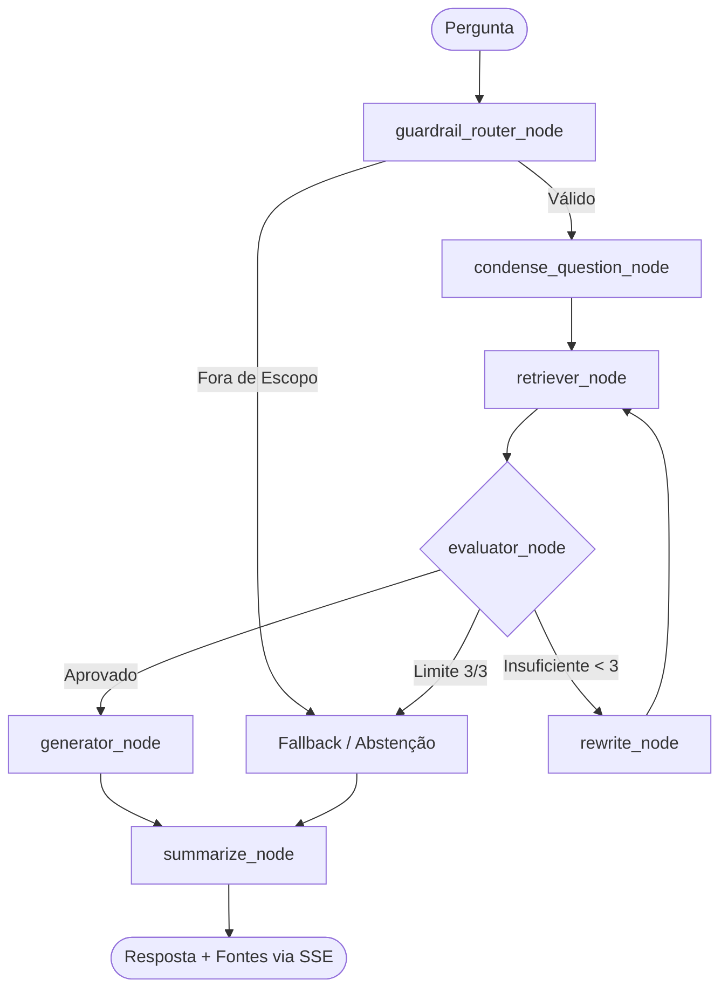

# NurseAsk

Assistente clínico para consulta de protocolos de enfermagem baseado em Agentic RAG (Corrective RAG), projetado para responder com precisão factual, rastreabilidade de fontes e baixa taxa de alucinação em modelos locais.

## Stack Tecnológica

| Camada | Tecnologias |
| :--- | :--- |
| **Backend e Streaming** | `Python 3.11+` `FastAPI` `Uvicorn` `SSE (Server-Sent Events)` |
| **Orquestração e LLM** | `LangGraph` `LangChain` `Ollama (llama3.1:8b)` `Pydantic v2 (json_schema)` |
| **Busca e Persistência** | `Elasticsearch` `Cross-Encoder Reranker` `Redis` |
| **Monitoramento e Avaliação** | `LangSmith` `DeepEval` |
| **Infraestrutura** | `Docker` `Docker Compose` |

## Como o Projeto Funciona

- **Ingestão automática:** lê e indexa os PDFs da pasta `data/` automaticamente na inicialização da API.
- **Chunking Parent-Child:** divide os documentos em trechos menores (*child*) para busca precisa e blocos maiores (*parent*) para contexto completo.
- **IDs determinísticos:** evita duplicação de documentos no Elasticsearch ao reiniciar a aplicação.
- **Busca híbrida:** combina busca léxica (BM25) e vetorial no Elasticsearch.
- **Reranking:** reordena os resultados com Cross-Encoder para priorizar os trechos mais relevantes.
- **Autocorreção em 3 ciclos:** valida se o contexto responde à pergunta e reescreve a consulta com sinônimos técnicos caso necessário.
- **Abstenção segura:** informa quando não há base nos protocolos em vez de inventar respostas.
- **Memória de conversa:** resume interações antigas no Redis (`summarize_node`) para não estourar o limite de tokens.
- **Observabilidade e testes:** rastreamento com LangSmith e validação automatizada com DeepEval.

## Arquitetura do Grafo (LangGraph)



## Como Executar com Docker

1. **Clonar o repositório e configurar variáveis de ambiente:**

2. **Subir os containers:**
```bash
docker compose up -d --build
```
*(A ingestão dos protocolos da pasta `data/` ocorre automaticamente quando a API inicia).*

3. **Baixar o modelo no Ollama (apenas na primeira execução):**
```bash
docker exec -it ollama ollama pull llama3.1:8b
```


